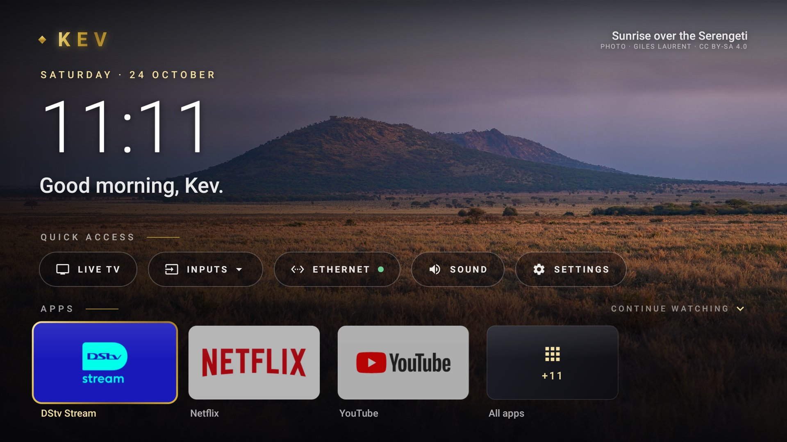

# Kev Launcher

A black-and-gold home screen for Android TV, built with Jetpack Compose for TV. It replaces the stock launcher with a clock, your favourite apps, quick access to inputs and settings, and a Continue watching row from YouTube and Netflix.



Built for and tested on a Hisense A4 (Android 9, 1080p). It should work on any Android TV running Android 7 or later.

## Features

- **Home:** a large clock and greeting over a slideshow of travel photos, with each photo's credit shown on screen.
- **Your name:** asked once on first run and shown in the gold wordmark and the greeting. Select the name at the top left to change it, or leave it blank.
- **Quick access:**
  - Live TV.
  - An **Inputs** drop-down listing the HDMI ports, with a green dot on ports that have something connected.
  - A **network** chip that shows Ethernet, Wi-Fi or Offline.
  - Sound and Settings.
- **Apps:** DStv, Netflix and YouTube pinned first. Everything else is on a separate All apps page.
- **App menu:** hold OK on any app to open it, see its info or uninstall it.
- **Continue watching:** scroll down from the home page.
  - **YouTube:** your watch history, with progress bars.
  - **Netflix:** its recommendations row. Netflix doesn't share watch history with other apps.
- **Light on weak TV chips:** the background only redraws during a photo change, and the shading is painted into the photo once instead of every frame.

To change which apps are pinned, edit `FAVOURITE_PACKAGES` in [`TvRepository.kt`](app/src/main/java/com/kev/launcher/TvRepository.kt).

## Install the APK (no computer needed)

1. On the TV, install **Downloader** (by AFTVnews) from the Play Store.
2. Allow it to install apps: Settings → Device Preferences → Security & restrictions → **Unknown sources** → turn on **Downloader**.
3. In Downloader, enter this link, then press **Install**:
   ```
   https://github.com/kevmaina001/android-tv-launcher/releases/latest/download/kev-launcher.apk
   ```
4. Open **Kev** from your apps. It asks for your name, then for permission to show Continue watching. Press **Allow**.

Kev now works when you open it from the apps row, but the HOME button still goes to the TV's own launcher, because Android TV has no "default launcher" setting. To make HOME open Kev, run this once over ADB, either from a computer or from a phone app such as Bugjaeger:
```
adb connect <tv-ip>
adb shell pm disable-user --user 0 com.google.android.tvlauncher
```
To undo it, run `adb shell pm enable com.google.android.tvlauncher`.

## Build from source

You need a computer with the [Android SDK platform tools](https://developer.android.com/tools/releases/platform-tools) (`adb`) and JDK 17 or later.

1. **Turn on debugging on the TV.**
   - Go to Settings → Device Preferences → About and select **Build** seven times.
   - Then go to Developer options and turn on **USB debugging** (on some TVs it's also called **Network debugging**).
2. **Find the TV's IP address** in Settings → Network.
3. **Build and install:**
   ```powershell
   $env:JAVA_HOME = "C:\Program Files\Java\jdk-21"   # wherever your JDK is
   powershell -ExecutionPolicy Bypass -File .\deploy.ps1 -Tv 192.168.1.50
   ```
   Accept the "Allow USB debugging?" prompt on the TV the first time.

`deploy.ps1` builds a release APK and installs it. It also:
- compiles the app ahead of time, so it opens instantly;
- grants the permission that Continue watching needs;
- makes Kev the home screen;
- presses HOME.

On macOS or Linux, run `./gradlew assembleRelease` and the same `adb` commands from the script.

**If the stock launcher keeps coming back:** some TVs ignore `set-home-activity`. Disabling the stock launcher fixes this:
```
adb shell pm disable-user --user 0 com.google.android.tvlauncher
```
Re-enable it with `pm enable` if you ever uninstall Kev.

## Licence

- **Code:** MIT, see [LICENSE](LICENSE).
- **Background photos** (`app/src/main/res/drawable-nodpi/bg_*.jpg`): from Wikimedia Commons under **CC BY-SA**, not MIT. See [CREDITS.md](CREDITS.md) for each photo's author and licence. Keep those credits if you reuse them.
- **Icons:** Material Design icons, Apache 2.0.
- **App logos:** not part of this repo. They're read from the apps installed on the TV.
